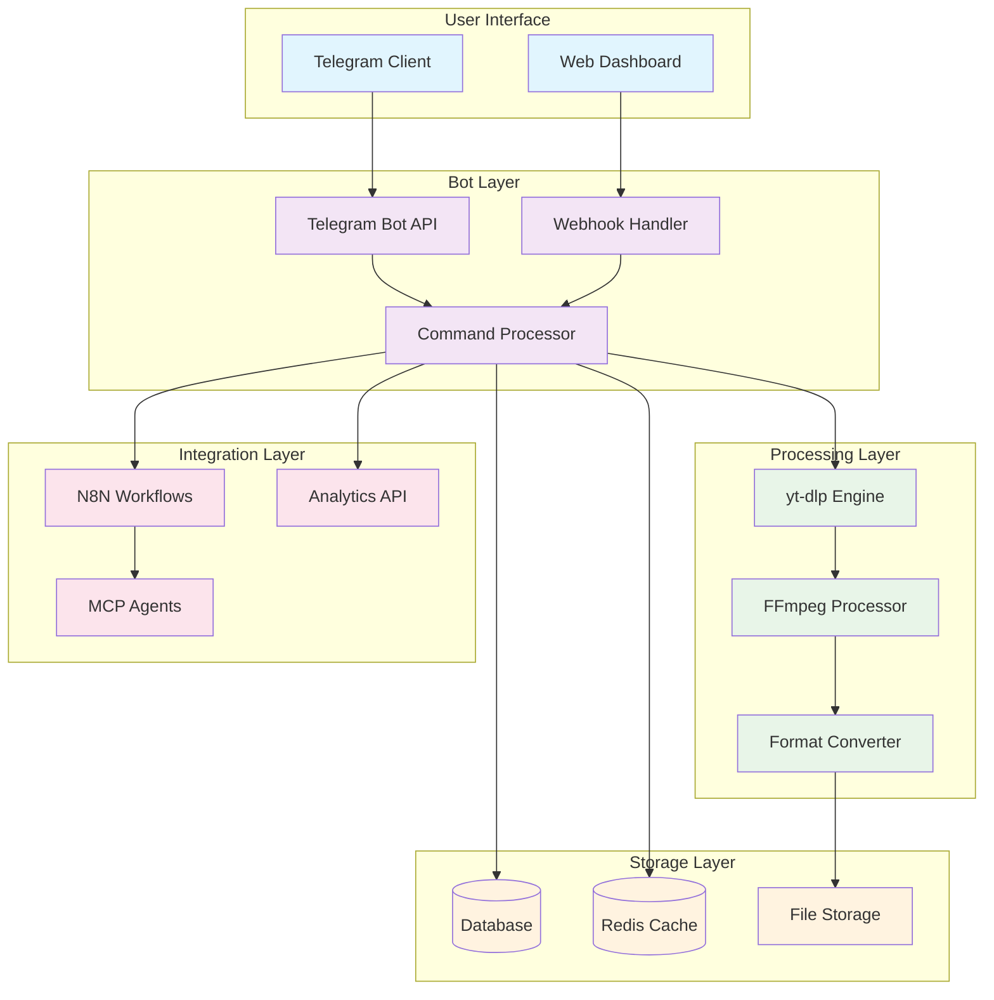
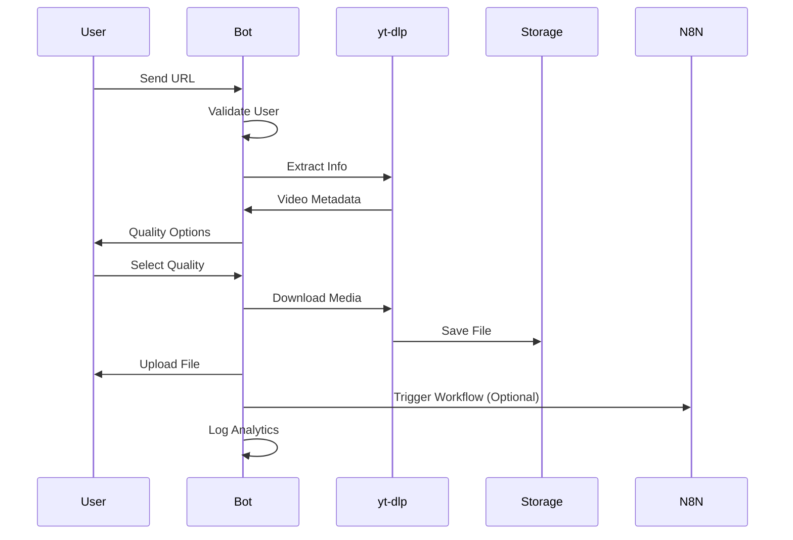
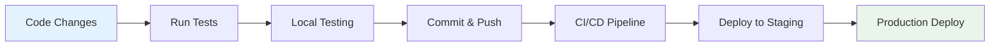
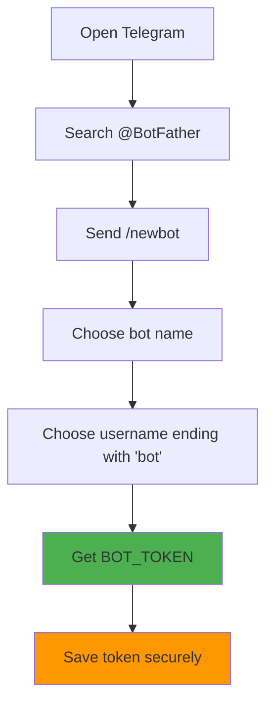
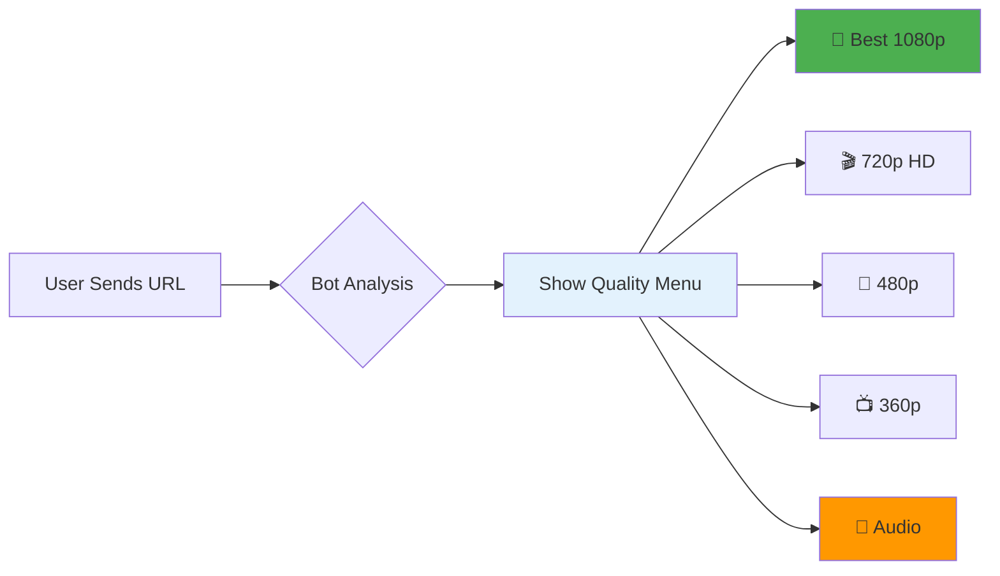

# 🚀 Automation Empire: 24/7 Bot Factory - Automation Toolkit for Developers

> Build production-ready Telegram bots with AI agents, N8N workflows, and monetization strategies. Complete automation framework for developers transitioning from manual work to scalable systems. Includes deployment guides, business integrations, and real-world examples Of media Downloader.

[](https://python.org)
[](https://core.telegram.org/bots/api)
[](https://docker.com)
[](LICENSE)
[](#deployment)

---

## 📋 Table of Contents

- [🎯 Why This Bot Matters](#-why-this-bot-matters)
- [✨ Features](#-features)
- [🏗️ Architecture](#️-architecture)  
- [🚀 Quick Start](#-quick-start)
- [💻 Local Development](#-local-development)
- [🤖 Bot Versions](#-bot-versions)
- [☁️ Cloud Deployment](#️-cloud-deployment)
- [🔧 Configuration](#-configuration)
- [📱 Usage Guide](#-usage-guide)
- [🤖 Bot Collection](#-bot-collection)
- [🔗 Integrations](#-integrations)
- [🛠️ Troubleshooting](#️-troubleshooting)
- [🤝 Contributing](#-contributing)

---
>  🚧 This repository already includes the most essential files you need to get your bot up and running, and I’ll keep adding more advanced resources 🔄 so you can fully understand and master the ins and outs of the entire system.

---

## 🎯 Why This Bot Matters

**Read the complete journey:** [From Marketing Noob Hacks to Automation Empire](https://medium.com/@mazini/from-marketing-noob-hacks-to-automation-empire-building-your-24-7-telegram-bot-heres-your-free-35990881ad7b)

This isn't just another download bot. It's a **gateway to automation mastery** that bridges the gap between marketing tactics and technical implementation. Born from real-world experience in CPA marketing and evolved into a comprehensive automation solution.

**What makes this different:**
- 🧠 **Psychology-Driven Design** - Built with user behavior insights
- 🔄 **Business Model Ready** - Supports affiliate integration and content lockers
- 🎛️ **Quality Control** - Multiple format and resolution options  
- 🌐 **Multi-Platform** - 1000+ supported sites via yt-dlp
- ⚡ **Performance Optimized** - Handles high-volume downloads
- 🔒 **Security First** - User authorization and rate limiting
- 📈 **Scalable Architecture** - From personal use to business deployment

---

## ✨ Features

### Core Functionality Of This Bot Example;
- 📺 **Video Downloads** - YouTube, Instagram, TikTok, Twitter, Facebook
- 🎵 **Audio Extraction** - MP3, M4A, WAV formats
- 🎛️ **Quality Selection** - 360p to 4K with size optimization
- ⚡ **Progress Tracking** - Real-time download progress
- 📊 **Format Options** - Video, audio-only, video+audio separate
- 🔄 **Batch Processing** - Multiple URLs support
- 💾 **Smart Caching** - Redis-powered performance optimization

### Advanced Features
- 👥 **Multi-User Support** - Authorized user management
- 📈 **Usage Analytics** - Download tracking and statistics
- 🚦 **Rate Limiting** - Configurable download limits
- 🛡️ **Security** - User authorization and admin controls
- 🔗 **Webhook Support** - N8N and MCP integration ready
- 🎨 **Custom Branding** - Personalized bot responses
- 📱 **Mobile Optimized** - Perfect for phone usage

### Business Features
- 💰 **Monetization Ready** - Affiliate link integration
- 🎯 **Marketing Funnel** - Content locker capabilities
- 📊 **Analytics Dashboard** - User behavior insights
- 🔄 **Automation Workflows** - N8N integration
- 🤖 **AI Agents** - MCP support for intelligent responses

---

## 🏗️ Architecture



### Bot Workflow



---

## 🚀 Quick Start

### Manual Setup

```bash
# Clone the repository
git clone https://github.com/yomazini/telegram-automation-bot-framework.git
cd telegram-automation-bot-framework

# Install dependencies
pip install -r requirements.txt

# Copy configuration template
cp .env.example .env

# Edit configuration (see Configuration section)
nano .env

# Run the bot (choose one)
# With FFmpeg for MP3 conversion
python bots/simple_bot.py

# Without FFmpeg (sends original audio format)
python bots/simple_bot_without_ffmpeg.py

# Full automation bot: media downloader, RP commands, guest mode support
python bots/automation_bot.py
```

### Full Automation Bot

`bots/automation_bot.py` is the production implementation added for hosting. It uses the Telegram Bot API directly so it can handle Bot API 10.0 guest updates, including `guest_message` and `answerGuestQuery`.

Features:
- Downloads media links with `yt-dlp`, uploads the result to Telegram, then deletes the temporary files.
- Stores RP commands globally per Telegram user in SQLite.
- Supports guest mode media downloads only. Guest messages never execute RP commands.
- Runs from `nix run .` and has a NixOS service module.

RP examples:

```text
/rp add hug {actor} hugs {target} {warmly|softly| }
hug @friend
```

If the trigger message is a reply, `{target}` becomes the replied user's display name. Otherwise the text after the trigger word is used as the target.
RP commands belong to the user who added them, not to the chat. Add `hug` once in DM with the bot, then use `hug @friend` in any group or chat where the bot can read your message.

Guest mode note: Telegram guest replies use `answerGuestQuery`, which sends an inline result. Local files cannot be uploaded directly in that call, so set `TELEGRAM_CACHE_CHAT_ID` to a private chat/channel where the bot can upload downloaded files and reuse the returned `file_id`.

### Nix / NixOS

Run locally:

```bash
BOT_TOKEN=123:token nix run .
```

NixOS module example:

```nix
{
  inputs.telegram-automation-bot.url = "path:/home/melvi/Work/telegram-automation-bot-framework";

  outputs = { self, nixpkgs, telegram-automation-bot, ... }: {
    nixosConfigurations.host = nixpkgs.lib.nixosSystem {
      system = "x86_64-linux";
      modules = [
        telegram-automation-bot.nixosModules.default
        {
          services.telegram-automation-bot = {
            enable = true;
            tokenFile = "/run/secrets/telegram-automation-bot-token";
            workDir = "/var/lib/telegram-automation-bot";
            downloadDir = "/var/lib/telegram-automation-bot/downloads";
            databasePath = "/var/lib/telegram-automation-bot/bot.sqlite3";
            cacheChatId = "-1001234567890";
          };
        }
      ];
    };
  };
}
```

The module rejects `/nix/store` work and download directories because the bot must write SQLite state and temporary media files at runtime.

### YouTube Bot Checks

If YouTube returns `Sign in to confirm you're not a bot`, export browser cookies to Netscape `cookies.txt` format and point yt-dlp at that file:

```nix
services.telegram-automation-bot.cookiesFile = "/var/lib/telegram-automation-bot/youtube-cookies.txt";
```

or in `.env`:

```env
YTDLP_COOKIES=/var/lib/telegram-automation-bot/youtube-cookies.txt
```

For a NixOS service, a cookie file is usually more reliable than `cookiesFromBrowser`, because the service user normally cannot read your desktop browser profile.

### Docker (Production Ready)

```bash
# Clone and configure
git clone https://github.com/yomazini/telegram-automation-bot-framework.git
cd telegram-automation-bot-framework
cp .env.example .env
# Edit .env with your credentials

# Start with Docker Compose
docker-compose up -d

# Check logs
docker-compose logs -f bot
```

---

## 💻 Local Development

### Prerequisites

- **Python 3.8+** - Core runtime
- **Git** - Version control
- **FFmpeg** - (Optional, for `simple_bot.py`) for converting audio to MP3.

### Installing FFmpeg

**Windows (using Chocolatey):**
```bash
choco install ffmpeg
```

**macOS (using Homebrew):**
```bash
brew install ffmpeg
```

**Linux (Debian/Ubuntu):**
```bash
sudo apt update && sudo apt install ffmpeg
```

### Development Setup

```bash
# Create virtual environment
python -m venv venv
source venv/bin/activate  # Linux/Mac
# venv\Scripts\activate   # Windows

# Install development dependencies
pip install -r requirements.txt

# Run tests
python -m pytest tests/
```

### Development Workflow



---

## 🤖 Bot Versions

This repository contains multiple bots for different purposes:

1.  **`pythonanywhere_bot.py` (Recommended for PythonAnywhere)**
    -   **Best for:** A best-effort, robust bot for deploying on PythonAnywhere's free tier.
    -   **Features:** Includes all known proxy workarounds, a `/test` command for diagnostics, and settings optimized for PythonAnywhere's restrictive environment. See the note below about potential issues.

2.  **`simple_bot.py`**
    -   **Best for:** Local development or servers where you have `ffmpeg` installed.
    -   **Features:** Downloads videos and converts audio to MP3 format.
    -   **Requires:** `ffmpeg` to be installed on the system.

3.  **`simple_bot_without_ffmpeg.py`**
    -   **Best for:** Environments where `ffmpeg` is not available or not needed.
    -   **Features:** Downloads videos and audio. Audio is sent in its original downloaded format (e.g., `.m4a`, `.webm`), avoiding the need for conversion.

---

## ☁️ Cloud Deployment

### 🥇 PythonAnywhere (Recommended - Free Forever)

**Why PythonAnywhere is Perfect:**
- ✅ **Free Forever** - No credit card required
- ✅ **24/7 Uptime** - Always-on consoles
- ✅ **Python Optimized** - Built for Python applications
- ✅ **Easy Setup** - Web-based IDE
- ✅ **Telegram Friendly** - Whitelisted API access

**Deployment Steps:**

```bash
# 1. Create free account at pythonanywhere.com
# 2. Open a new Bash console

# 3. Clone the repository
git clone https://github.com/yomazini/telegram-automation-bot-framework.git
cd telegram-automation-bot-framework

# 4. Set up your environment
cp .env.example .env
nano .env # Add your BOT_TOKEN and AUTHORIZED_USER

# 5. Run the PythonAnywhere bot
python bots/pythonanywhere_bot.py
```
**⚠️ Important Note on PythonAnywhere:** Free accounts on PythonAnywhere have very strict network restrictions. While this bot includes all known workarounds, you may still experience errors (`403 Forbidden`, timeouts). This is a platform limitation, not a bug in the code. For guaranteed reliability, we recommend deploying on a different platform like **Railway** or **Render**, or upgrading to a paid PythonAnywhere account.

### 🚂 Railway (Easiest Git-Based Deployment)

```bash
# 1. Push your code to GitHub
git push origin main

# 2. Connect to railway.app with GitHub
# 3. Select your repository
# 4. Add environment variables in Railway dashboard

# Automatic deployment on git push!
```

**Railway Template:**
```json
{
  "build": {
    "builder": "NIXPACKS"
  },
  "deploy": {
    "startCommand": "python bots/simple_bot_without_ffmpeg.py",
    "restartPolicyType": "ON_FAILURE"
  }
}
```

### 🎨 Render (Free with Sleep Mode)

```yaml
# render.yaml
services:
  - type: web
    name: telegram-bot
    env: python
    buildCommand: pip install -r requirements.txt
    startCommand: python bots/simple_bot_without_ffmpeg.py
    plan: free
```

### ☁️ Oracle Cloud (Most Powerful - Free Forever)

Oracle Cloud provides a powerful free tier. You can follow standard Linux deployment steps, and choose whichever bot script you prefer.

### 📊 Deployment Comparison

| Platform | Cost | Uptime | Setup | Best For |
|----------|------|--------|-------|----------|
| **PythonAnywhere** | 🟢 Free | 🟢 24/7 | 🟢 Easy | Personal Use |
| **Railway** | 🟡 $5/month | 🟢 24/7 | 🟢 Easiest | Developers |
| **Render** | 🟢 Free* | 🟡 Sleeps | 🟢 Easy | Testing |
| **Oracle Cloud** | 🟢 Free | 🟢 24/7 | 🔴 Complex | Power Users |

*Free tier sleeps after 15 minutes of inactivity

---

## 🔧 Configuration

### Basic Configuration (.env)

For More Details Check [Detailed and Visual Article](https://medium.com/@mazini/from-marketing-noob-hacks-to-automation-empire-building-your-24-7-telegram-bot-heres-your-free-35990881ad7b)

```bash
# Telegram Bot Credentials (Required)
BOT_TOKEN=1234567890:ABCdefGHIjklMNOpqrsTUVwxyz   # From @BotFather

# User Management (Required)
AUTHORIZED_USER=123456789,987654321               # Comma-separated user IDs

# Bot Settings
LOG_LEVEL=INFO                                    # Logging level
DEBUG_MODE=False                                  # Debug mode
```

### Getting Your Credentials

#### 1. Bot Token (from @BotFather)



#### 2. User IDs (from @userinfobot)

```bash
# Method 1: @userinfobot
# Send any message to @userinfobot
# Bot replies with your numeric ID

# Method 2: Forward message to @RawDataBot  
# Forward any message to @RawDataBot
# Shows detailed user information
```

---

## 📱 Usage Guide

### Bot Commands

| Command | Description | Example |
|---------|-------------|---------|
| `/start` | Initialize bot and show welcome | `/start` |
| `/help` | Show help and available commands | `/help` |

### Supported Platforms

#### Video Platforms
- 🎬 **YouTube** - Videos, shorts, playlists, live streams
- 📱 **TikTok** - Videos with/without watermarks
- 📸 **Instagram** - Posts, reels, stories, IGTV
- 🐦 **Twitter** - Videos, GIFs, embedded media
- 👥 **Facebook** - Public videos and posts
- 🎮 **Twitch** - Clips and VODs
- 📺 **Vimeo** - Videos and live streams

#### Audio Platforms
- 🎵 **SoundCloud** - Tracks and playlists
- 🎼 **Bandcamp** - Albums and tracks
- 📻 **Mixcloud** - DJ sets and radio shows

#### And 1000+ more via yt-dlp!

### Quality Options



### User Interface Flow

**Expected Bot Interaction:**

```
👤 User: https://www.youtube.com/watch?v=dQw4w9WgXcQ

🤖 Bot: 
📹 Rick Astley - Never Gonna Give You Up
👤 Rick Astley
⏱️ Duration: 3:32
📊 Views: 1.4B

Choose quality:
[🎥 Best Quality] [🎬 720p]
[📱 480p]
[🎵 Audio Only]

👤 User: *clicks 720p HD*

🤖 Bot: ⬇️ Downloading in 720p... 
📊 Progress: ████████ 45%

🤖 Bot: ⬆️ Uploading to Telegram...

🤖 Bot: ✅ Here's your video!
📁 Rick_Astley_Never_Gonna_Give_You_Up.mp4
💾 Size: 15.3 MB
🎬 Quality: 720p
⏱️ Process time: 23 seconds
```

---

## 🤖 Bot Collection

> **Inspired by:** [Awesome Telegram Bots](https://github.com/DenisIzmaylov/awesome-telegram-bots)

A curated list of useful Telegram bots can be found in the original repository.

---

## 🔗 Integrations

This project is designed to be extensible. You can integrate it with automation tools like N8N or AI agent frameworks. For more ideas, check out the original repository's sections on N8N and MCP.

---

## 🛠️ Troubleshooting

### Common Issues and Solutions

#### 🚫 Authorization Errors

**Problem:** `"You are not authorized to use this bot."`

**Solution:**
1. Send a message to [@userinfobot](https://t.me/userinfobot) to get your numeric user ID.
2. Add your ID to the `AUTHORIZED_USER` variable in your `.env` file.
3. Restart the bot.

#### 🎵 FFmpeg Not Found

**Problem:** The bot fails when trying to download audio with `simple_bot.py`.

**Solution:**
- Install FFmpeg using the instructions in the [Local Development](#-local-development) section.
- Alternatively, use `simple_bot_without_ffmpeg.py`, which does not require FFmpeg.

#### 🌐 Network/Hosting Issues on PythonAnywhere

**Problem:** The bot cannot download videos on PythonAnywhere, showing `403 Forbidden` or other proxy errors.

**Solution:**
- **This is a platform limitation of PythonAnywhere's free tier.** The proxy blocks access to many video sites.
- Make sure you are running `bots/pythonanywhere_bot.py`, which contains all possible workarounds.
- Use the `/test` command to diagnose the connection. If it fails, the platform's restrictions are likely the cause.
- For better reliability, we strongly recommend deploying on **Railway**, **Render**, or upgrading to a paid PythonAnywhere account.

---

## 🧪 Testing

### Unit Tests

This project is set up for testing with `pytest`.

```bash
# Run all tests
python -m pytest tests/

# Run with coverage
python -m pytest tests/ --cov=bots/
```

### Manual Testing Checklist

- [ ] Bot starts without errors
- [ ] `/start` command works
- [ ] User authorization works
- [ ] URL validation works
- [ ] Quality selection appears
- [ ] Download completes successfully
- [ ] File upload to Telegram works
- [ ] Error handling is graceful

---

## 🔐 Security Best Practices

### Environment Variables

Never commit your `.env` file to Git. It contains sensitive credentials. The `.gitignore` file is already configured to ignore it.

### Input Validation

The bot performs basic URL validation. For production systems, consider more robust validation against a list of allowed domains.

---

## 📚 Resources and Learning

### Essential Reading

- **[Bot Journey Article](https://medium.com/@mazini/from-marketing-noob-hacks-to-automation-empire-building-your-24-7-telegram-bot-heres-your-free-35990881ad7b)** - The complete story behind this bot
- **[Telegram Bot API Documentation](https://core.telegram.org/bots/api)** - Official API reference
- **[yt-dlp Documentation](https://github.com/yt-dlp/yt-dlp)** - Media download engine docs


---

<div align="center">

**⭐ Star this repo if it helped you!**

[](https://github.com/yomazini/telegram-automation-bot-framework)
[](https://twitter.com/mazini_youssef)

**Share the knowledge • Build together • Automate everything**

</div>
